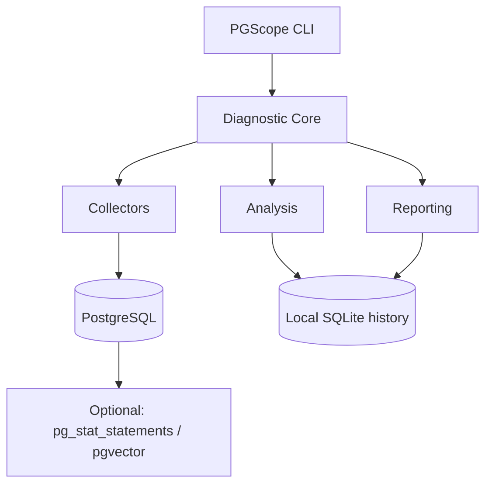

# Architecture

PGScope is a modular Go monolith. Capabilities live under `internal/`; shared domain types live in `pkg/models`.

## Packages

| Package | Role |
|---------|------|
| `cmd/pgscope` | Entrypoint |
| `internal/cli` | Cobra commands |
| `internal/config` | YAML + env |
| `internal/database` | Safe pgx pool, redaction |
| `internal/collector` | Version-aware snapshot collection |
| `internal/sqlsafe` / `internal/explain` | EXPLAIN validation + plan diagnostics |
| `internal/vector` | pgvector discovery, recall, tune |
| `internal/rules` / `internal/diagnosis` | Evidence-based findings |
| `internal/telemetry` | Metric extraction + counter deltas |
| `internal/history` | SQLite persistence |
| `internal/regression` | Baseline comparisons |
| `internal/incident` | Correlation, hypotheses, timelines |
| `internal/monitor` | Continuous scheduler |
| `internal/report` | Text / JSON / YAML |

## Design rules

1. Collectors emit **facts** (or limitations)—never invent metrics.
2. Rules emit findings with evidence and confidence **rationale** (not fake percentages).
3. Hypothesis edges never assert unproven `CAUSES`.
4. One-shot CLI commands work without the monitor or history backend.
5. Expensive benchmarks (vector recall/tune, `EXPLAIN ANALYZE`) are opt-in with explicit authorization flags.

See also the root [ARCHITECTURE.md](../ARCHITECTURE.md) for phase boundaries.
